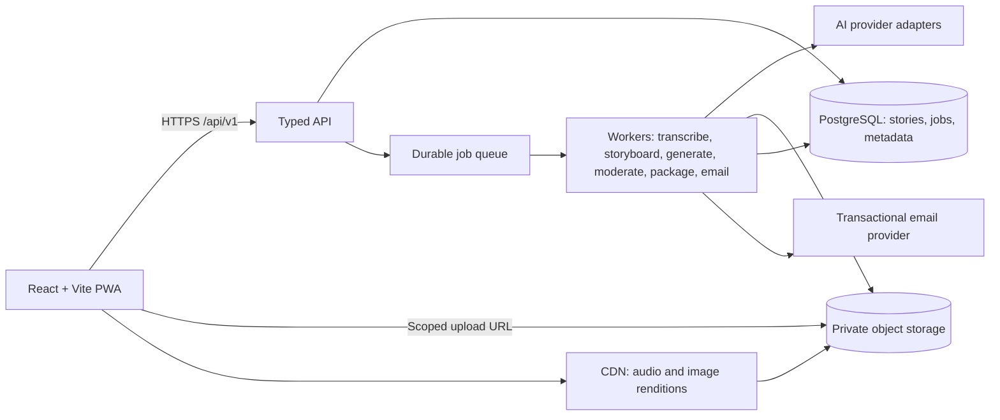

# Oralia — Architecture & Blueprint

**Status:** Local database/API implementation plus production blueprint
**Date:** 5 November 2026
**Product:** Audio-first discovery, creator storyboards, and four-tier education.

## Implemented local architecture

React/Vite → validated fetch client → TypeScript Vite middleware → Prisma/libSQL adapter → SQLite. `vite.config.ts` alone imports `server/plugin.ts`; no React import graph reaches Prisma, the generated client, adapters, or Node APIs. Dev and preview share the same `/api/v1` handlers. A static client deployment alone does not supply these endpoints.

`prisma/schema.prisma` defines `User`, `Story`, `KeyframeScene`, `Bookmark`, `OtpChallenge`, and `Session`. The initial SQL migration is committed. The local database is ignored at `prisma/oralia.db`; Prisma 7 connection/seed settings live in `prisma.config.ts`. `server/databaseUrl.ts` supplies the root-relative default or the process's `DATABASE_URL` override.

| Model | Current persisted contract |
|---|---|
| User | ID, name, unique username/email, avatarUrl, bio, CREATOR/READER role, preferredVoiceType; owns stories, bookmarks and sessions. |
| Story | ID, title, description, canonical ageTier, regionTag, audioUrl, optional originalAudioUrl, ORIGINAL/STUDIO_AI voiceType, duration in seconds, authorId; also sourceTitle/sourceUrl/culturalNote, featured and publishedAt. |
| KeyframeScene | ID, storyId, unique sceneNumber per story, title, narrationText, imageUrl, timestamp in seconds, photographer and photo-source URL. |
| Bookmark | ID and unique userId/storyId pair; API authorizes current user. |
| OtpChallenge | ID, normalized email, five-minute expiry, consumed flag. No actual PIN is sent or stored. |
| Session | Hashed bearer token ID, userId, seven-day expiry. Raw token is returned only to the signing-in client. |

AgeTier remains `5-9 | 10-13 | 14-17 | 18+`; UI uses en dashes. SQLite stores one validated tier per seed story. `server/catalog.ts` adapts each row into the shared `Story` contract with exactly that `tierVariants[ageTier]`. A scene's endTime is the next timestamp or the measured story duration. Zod validates the response, tier, timeline and boundaries. The seed's publication/age assignments are editorial fixtures in the database, not a live review service or formal school certification. Future multi-variant persistence is described below.

Eight source-attributed English adaptations provide two tales per tier, 32 scenes and four **editorial collection** profiles. They are abridged from identified historical collections, not invented author testimonials or certified community recordings. All narration is synthetic `STUDIO_AI`; no original microphone or reviewed dialect tracks are seeded. `prisma/content/stories.json` is a seed input only and is never imported by React. `narration.json` records boundaries measured from the bundled PCM files. Reseeding upserts catalog records and preserves user accounts, sessions and bookmarks. Unsplash scene images carry photographer/source credit; no catalog or image failure substitutes an unrelated story.

### Implemented routes

All paths use `/api/v1`. JSON responses have no-store headers. Public profile/catalog responses omit email and session secrets.

| Method + path | Behavior |
|---|---|
| GET /health | Check SQLite availability. |
| GET /catalog | Return DB stories, ordered scenes and creator profiles; no in-memory fallback. |
| GET /stories/:storyId | Return one adapted DB Story or 404. |
| GET /creators/:username | Return one public CreatorProfile or 404. |
| GET /media-status?url=/media/name.wav | Check a bounded local media path; missing assets return available:false before the browser requests audio. |
| POST /auth/otp/request | Validate email; create expiring challenge, returning challengeId, expiresAt and simulated:true. Reserved editorial addresses are rejected. |
| POST /auth/otp/verify | Accept any six digits, atomically consume a valid challenge, create/find creator, and return CreatorSession. |
| GET /auth/session | Resolve an unexpired bearer session from its stored hash. |
| POST /auth/logout | Revoke the current session. |
| PATCH /me/voice | Authorize user and persist ORIGINAL or STUDIO_AI preference; return refreshed CreatorSession. |
| GET /bookmarks | Return current user's storyIds. |
| PUT /bookmarks/:storyId | Authorize current user and idempotently save a valid story. |
| DELETE /bookmarks/:storyId | Authorize current user and idempotently remove the bookmark. |

The local OTP simulator deliberately does not verify email ownership and sends no email. The animated email → sending → PIN flow accepts any six-digit entry as requested. Challenges are single-use, database sessions expire, and account writes are server-scoped. `usePersistentSession` persists the simulator session in localStorage (`oralia-creator-session`), validates it against the API after reload, supports a storage-blocked current-page session, and revokes it on logout. This local presentation flow must be replaced with verified provider authentication for production.

### Current state and playback ownership

| State | Owner |
|---|---|
| Catalog loading/refresh/error/retry and DB response | useDatabaseCatalog + src/lib/api.ts; fetch AbortController and Zod validation. Existing data remains visible during refresh; unresolved public pages show CatalogStatusModal until refresh succeeds or can be retried. |
| Shared age/mode/theme | App; theme preference only in oralia-editorial-theme. |
| Public story/profile URL | usePublicView; shareable #stories/:id and #creators/:username, including browser history. |
| Creator session | usePersistentSession + CreatorSessionContext; validated API/localStorage boundary. |
| Account bookmarks | SQLite/API; useStoryBookmark owns pending/feedback. Guest IDs remain device-local. |
| Voice Quality Safeguard | User.preferredVoiceType through PATCH /me/voice; exported as bundle.voiceType. |
| Audio and cue state | useAudioCarousel around one HTMLAudioElement; no second accumulating playback clock. |
| Missing audio source | usePlaybackSource + Web Audio-generated quiet WAV timing tone; stale synthesis work and blob URLs released on replacement/unmount. |
| Caption/voice/volume controls | Local player state; only supplied English caption track selectable. Dialect overlay states when a reviewed track is absent. Original voice with no supplied recording uses an explicitly labeled tone; Studio AI selects spoken seed narration. |
| Search/region filter | VellumFeed / EducationFeed local UI state over the same DB catalog. |
| Recording/pitch/storyboard | CreatorStudio and useStudioRecording; drafts remain local to the mounted studio. |
| Draft playback transport | AudioDraftPlayer reads the recording hook's HTMLAudioElement; themed play/pause, seek/time, and shared VolumeControl. Recorder containers with unknown duration become seekable after their first complete playback. |

Play/pause, waveform/timeline drags, transcript cues and all four chapter cards use the same media clock. A paint-aligned loop publishes discrete cue changes; timeupdate updates progress. Decoded images crossfade and retain the previous image on a later failure; thumbnails retain the scene's readable identity. Volume Escape dismisses its panel without closing the containing reader. Public navigation unmounts the only player and stops audio. Both themes preserve rounded geometry, focus visibility and reduced motion.

Studio recording has microphone-free practice and optional MediaRecorder modes. Voice preference selects the production plan and never claims to synthesize a new recording. Preview/export assemble the selected database storyboard with current edits. The real ZIP contains four images, ordered prompts/durations, source/photographer attribution and checksums. Its independent timeline does not rewrite the source narration. AI preparation and email remain explicit simulations; durable AI jobs, private exports and real delivery are future work.

**Final cleanup — 6 November 2026:** PIN success updates the navbar directly from the persisted session before catalog refresh finishes. New profile links show loading/retry feedback while their database profile is fetched; avatar image failure displays initials without losing the username or accessible link. Saving a new session clears stale sign-out notices. Modal focus is captured before dialog auto-focus and restored to the trigger, or to main content if that trigger has been removed. The compact navigation also covers tablet widths through 900px. Source URL adaptation repairs two legacy Gutenberg chapter fragments (`ch01`/`ch02` to verified `ch1`/`ch2`) for existing records without rewriting SQLite; future seed inputs already carry the corrected fragments.

The remaining sections describe the production target. They do not imply the queue, PostgreSQL, providers, offline PWA or signed-link email flow are already deployed.

## 1. Architecture goals

- Keep recorded audio as the canonical timeline; show keyframe art in a React carousel without rendering a video file.
- Let the same story carry four editorially distinct age variants: `5-9`, `10-13`, `14-17`, and `18+`.
- Make expensive transcription, image generation, and packaging work asynchronous, resumable, observable, and safe to retry.
- Keep AI, storage, and email credentials behind server-side provider adapters.
- Support weak or interrupted connectivity, user-selected offline stories, captions, dialect metadata, and accessible player controls.
- Preserve storyteller consent, attribution, content ratings, and corrections as first-class data.

## 2. System shape



### Recommended deployment boundaries

- **Web:** React, TypeScript, Tailwind CSS, Vite. Progressive enhancement for install/offline use.
- **API:** Node.js + TypeScript service, versioned REST endpoints, schema validation at the boundary. Keep this service stateless apart from database/object storage.
- **Persistence:** PostgreSQL for users/consent, stories, tier variants, job state, asset manifests, and email outbox. Use a durable queue with dead-letter handling; queue choice is an infrastructure decision.
- **Media:** Private S3-compatible object storage for originals, renditions, generated images, and ZIP exports; CDN for public/approved playback assets. Do not persist large media blobs in PostgreSQL.
- **Workers:** Separate worker process or managed task service for slow AI/image/ZIP/email jobs. Each job step records state, retry count, timestamps, provider request IDs, and safe error summaries.
- **Provider adapters:** `TranscriptionProvider`, `StoryboardProvider`, `ImageProvider`, `ModerationProvider`, `ObjectStorageProvider`, and `EmailProvider`. Keep model IDs and vendor-specific request fields out of the UI and domain records.

## 3. Main processing flows

### Mode 1 — Vellum

1. Storyteller records locally or uploads a completed audio file. Record MIME type, duration, file size, checksum, consent/rights choice, language hint, and dialect hint.
2. Server creates a story job; audio uploads directly to private storage using a scoped URL.
3. Worker transcribes the original language, identifies useful segment boundaries, and creates a reviewed transcript with timestamped story beats. Reject out-of-range and non-monotonic times.
4. Storyboard step produces an audio-aligned keyframe plan and a separate variant for each requested age tier. A creator/editor can correct transcript, beats, prompts, and audience before generation/publishing.
5. Generate image assets per keyframe/tier; apply text/image moderation and content policy; hold flagged/uncertain output for human review.
6. Publish a story record with audio and images on the media CDN. At playback, a single audio element drives the active keyframe and subtitle cues.

### Mode 2 — Creator & Game Studio

1. Creator records or uploads a pitch and chooses desired output tiers, asset types, and notification email.
2. Create an asynchronous `creatorJob`; return `202` and a status URL immediately.
3. Worker transcribes pitch, creates an editable concept/storyboard, generates requested concept frames, and saves prompts and assets.
4. Packaging worker creates a versioned archive (`README.md`, storyboard JSON, prompt/asset manifest, image files, selected transcript/captions) and records checksum/size/expiry.
5. Mark export ready and enqueue one email notification via a transactional outbox. Email contains a protected application link; the authorized download page mints a short-lived signed object URL.

### Mode 3 — Education & Schooling

1. Curators approve stories and age-specific adaptations; public feed endpoints only return published, reviewed variants for a requested age tier.
2. Feed selects `tierVariants[ageTier]`, including age-appropriate story text/captions, illustration style, content rating, and keyframe assets.
3. Player offers original-language captions, dialect label/overlay, translation where available, and saved-for-offline controls.
4. Educator controls/curation metadata and consent boundaries remain separate from public story content. School-facing use should begin with a privacy and child-safety review.

## 4. Component hierarchy

### Implemented local application

```text
App (mode, age, theme; CreatorSessionContext; useDatabaseCatalog)
├─ Navbar / DropdownSelect / account profile / sign-in or sign-out
├─ VellumFeed → StoryCard / CreatorByline / CreatorAvatar
├─ CreatorAccessGate or CreatorStudio (simulated persistent creator session)
│  ├─ Voice Quality Safeguard / useStudioRecording
│  ├─ StoryboardEditor / StoryboardPreviewModal
│  └─ ExportModal → buildManifest / packageStoryboard
├─ EducationFeed (shared age, local region filter, DB stories)
└─ One public/auth modal
   ├─ ListeningRoomModal → CarouselPlayer → useAudioCarousel
   │  ├─ PlaybackWaveform / KeyframeTimeline / SceneThumbnail
   │  ├─ CaptionTranscript / VolumeControl / useStoryBookmark
   │  └─ usePlaybackSource → timing tone only when source is absent
   ├─ CreatorProfileModal → published, author-scoped StoryCard grid
   ├─ UnavailablePublicViewModal
   └─ CreatorSignInModal → email / sending / six-digit PIN
```

The catalog and public profile data are server-owned. Profiles filter by exact creatorId and the shared age-eligibility helper; missing variants and unknown links show explicit unavailable states. No playback or login is mounted in discovery. Public story/profile links remain accessible to guests.

### Planned production hierarchy

```text
App
├─ AppShell
│  ├─ Header / ModeSwitcher
│  ├─ ConnectionStatus
│  └─ RouteOutlet
├─ VellumRoute
│  ├─ RecordStoryPage
│  │  ├─ RecorderControls
│  │  ├─ RecordingPermissionHelp
│  │  └─ UploadProgress
│  ├─ StoryReviewPage
│  │  ├─ TranscriptEditor
│  │  ├─ KeyframeTimelineEditor
│  │  └─ TierVariantPreview
│  └─ StoryPlayerPage
│     ├─ AudioController (one HTMLAudioElement)
│     ├─ SyncedCarousel
│     ├─ CaptionTrack / DialectOverlay
│     └─ AccessiblePlayerControls
├─ CreatorStudioRoute
│  ├─ PitchRecorder / PitchUploader
│  ├─ CreatorJobForm
│  ├─ JobProgress
│  └─ ExportReadyPanel
└─ EducationRoute
   ├─ AgeTierSelector
   ├─ CuratedFeed
   ├─ StoryCard
   └─ StoryPlayerPage (same player as Mode 1)
```

Shared UI must not duplicate audio synchronization logic. `SyncedCarousel` accepts a selected `StoryVariant`; it does not own the audio clock. The audio controller should survive slide changes and only be recreated when the audio asset/story changes.

## 5. Planned production state management

| State domain | Owner | Update pattern |
|---|---|---|
| Stories, feed pages, job status, export metadata | TanStack Query or equivalent server-state cache | Fetch via typed API client; key by story/job/age tier; invalidate or poll with bounded intervals; treat server as source of truth. |
| Playback clock | `PlaybackController` wrapping one `HTMLAudioElement` | Read `currentTime` in a frame loop while playing; publish only discrete active-frame/subtitle changes. React subscribes through `useSyncExternalStore` or a focused hook. |
| Playback controls | Player component/local reducer | Play/pause, seek drag, selected track, volume, rate. Reconcile with actual media events, not optimistic assumptions. |
| UI preferences | Small Zustand store or local state | Selected mode, non-sensitive preferences, dismissed notices. Keep URL as owner for shareable feed/tier filters. |
| Recording/upload draft | IndexedDB-backed draft service | Persist local recording metadata/blob and upload retry state; recover after reload and show explicit pending status. |
| Offline assets | Service-worker Cache Storage + IndexedDB index | Store app shell, bounded images, and explicitly saved audio; surface download/eviction status. |
| Backend workflow status | PostgreSQL + durable queue | State transitions and retries are server-authoritative; client refresh must safely rejoin an existing job. |

Avoid a single global store for all data. Do not put audio bytes, generated image Base64, signed URL tokens, or full transcripts into local-storage state.

## 6. Shared domain model

### Canonical age tiers

`AgeTier = "5-9" | "10-13" | "14-17" | "18+"`

Every published story has one or more approved `tierVariants`, keyed by these canonical strings. Each variant contains an editorial summary, rating/review state, visual style, captions, and image sequence. Feed filtering uses the requested tier, never an age inferred from a profile. A story without an approved variant is not returned for that tier. Unless there is a separately created narration track with its own alignment, a tier variant changes curation and visuals; it does not rewrite what the storyteller said. Captions remain the original transcript or a faithful, timestamp-aligned translation, with source segment IDs for review.

### Common keyframe and variant contract

```json
{
  "ageTier": "10-13",
  "contentRating": "family-adventure",
  "reviewStatus": "approved",
  "stylePreset": "adventure-graphic-novel",
  "editorialSummary": "A curious child follows a bird toward a river.",
  "captions": [
    {
      "startSeconds": 0.0,
      "endSeconds": 3.8,
      "text": "The river path led to the old baobab.",
      "language": "en",
      "dialect": null,
      "kind": "translation",
      "sourceSegmentIds": ["seg_001"]
    }
  ],
  "keyframes": [
    {
      "id": "kf_001",
      "startSeconds": 0.0,
      "endSeconds": 4.2,
      "imageAssetId": "asset_img_001",
      "imageUrl": "https://media.example.test/stories/story_001/kf_001.webp",
      "altText": "A young traveler follows a river path toward a broad baobab tree.",
      "promptVersion": "oralia-tier-v1"
    }
  ]
}
```

Times are seconds from the start of the canonical audio. `imageUrl` is included here to make mock payloads easy to preview; production should use CDN URLs generated for approved assets. The API validates ordering, duration bounds, uniqueness, MIME types, review state, and every tier's rating.

## 7. Mock JSON payloads

These examples are deliberately small mock records. They show all four tier keys and the distinct data each mode needs; real IDs, URLs, and transcript text come from the server pipeline.

### Mode 1 — Vellum

```json
{
  "mode": "core-social",
  "storyId": "story_001",
  "status": "published",
  "storyteller": { "id": "person_041", "displayName": "Nandi M.", "attribution": "name" },
  "audio": {
    "assetId": "asset_audio_001",
    "url": "https://media.example.test/audio/story_001.mp3",
    "mimeType": "audio/mpeg",
    "durationSeconds": 62.4,
    "language": "zu",
    "dialect": "curator-supplied-label"
  },
  "sourceTranscript": [
    { "startSeconds": 0.0, "endSeconds": 4.2, "text": "Kwathi ngelinye ilanga...", "language": "zu", "dialect": "curator-supplied-label" }
  ],
  "availableTiers": ["5-9", "10-13", "14-17", "18+"],
  "tierVariants": {
    "5-9": { "contentRating": "gentle-folktale", "reviewStatus": "approved", "stylePreset": "soft-fairytale", "editorialSummary": "A child follows a friendly bird along a sunny path.", "captions": [{ "startSeconds": 0.0, "endSeconds": 4.2, "text": "Kwathi ngelinye ilanga...", "language": "zu", "dialect": "curator-supplied-label", "kind": "original", "sourceSegmentIds": ["seg_001"] }], "keyframes": [{ "id": "kf_5_9_001", "startSeconds": 0.0, "imageAssetId": "img_5_9_001", "imageUrl": "https://media.example.test/5-9/001.webp", "altText": "A child follows a bright bird along a sunny path." }] },
    "10-13": { "contentRating": "family-adventure", "reviewStatus": "approved", "stylePreset": "adventure-graphic-novel", "editorialSummary": "A curious child follows a bird toward the river.", "captions": [{ "startSeconds": 0.0, "endSeconds": 4.2, "text": "Kwathi ngelinye ilanga...", "language": "zu", "dialect": "curator-supplied-label", "kind": "original", "sourceSegmentIds": ["seg_001"] }], "keyframes": [{ "id": "kf_10_13_001", "startSeconds": 0.0, "imageAssetId": "img_10_13_001", "imageUrl": "https://media.example.test/10-13/001.webp", "altText": "A curious child follows a bird toward a river." }] },
    "14-17": { "contentRating": "ya-drama", "reviewStatus": "approved", "stylePreset": "cinematic-ya", "editorialSummary": "The bird draws a young traveler toward a hidden crossing.", "captions": [{ "startSeconds": 0.0, "endSeconds": 4.2, "text": "Kwathi ngelinye ilanga...", "language": "zu", "dialect": "curator-supplied-label", "kind": "original", "sourceSegmentIds": ["seg_001"] }], "keyframes": [{ "id": "kf_14_17_001", "startSeconds": 0.0, "imageAssetId": "img_14_17_001", "imageUrl": "https://media.example.test/14-17/001.webp", "altText": "A young traveler watches a bird near a shadowed river crossing." }] },
    "18+": { "contentRating": "adult-historical-drama", "reviewStatus": "approved", "stylePreset": "cinematic-concept", "editorialSummary": "The crossing connects a traveler to a deeper family history.", "captions": [{ "startSeconds": 0.0, "endSeconds": 4.2, "text": "Kwathi ngelinye ilanga...", "language": "zu", "dialect": "curator-supplied-label", "kind": "original", "sourceSegmentIds": ["seg_001"] }], "keyframes": [{ "id": "kf_18_plus_001", "startSeconds": 0.0, "imageAssetId": "img_18_plus_001", "imageUrl": "https://media.example.test/18-plus/001.webp", "altText": "A traveler studies an old river crossing at dusk." }] }
  },
  "publication": { "visibility": "public", "publishedAt": "2026-11-04T08:00:00Z", "consentRecordId": "consent_001" }
}
```

### Mode 2 — Creator & Game Studio

```json
{
  "mode": "creator-studio",
  "jobId": "job_205",
  "status": "generating",
  "createdAt": "2026-11-04T08:15:00Z",
  "request": {
    "projectName": "The Moon Weaver",
    "creatorId": "person_081",
    "notificationEmail": "creator@example.test",
    "audioUploadId": "upload_205",
    "sourceLanguage": "en",
    "targetTiers": ["10-13", "14-17", "18+"],
    "deliverables": ["transcript", "storyboard-json", "generated-images", "prompt-manifest", "zip"]
  },
  "storyboardByTier": {
    "5-9": null,
    "10-13": { "stylePreset": "adventure-graphic-novel", "contentRating": "family-adventure", "frames": [{ "id": "frame_01", "startSeconds": 0.0, "prompt": "A young apprentice discovers a silver thread beneath a moonlit tree." }] },
    "14-17": { "stylePreset": "cinematic-ya", "contentRating": "ya-fantasy", "frames": [{ "id": "frame_01", "startSeconds": 0.0, "prompt": "A determined apprentice discovers a silver thread beneath an ancient tree at night." }] },
    "18+": { "stylePreset": "cinematic-concept", "contentRating": "adult-fantasy", "frames": [{ "id": "frame_01", "startSeconds": 0.0, "prompt": "An adult apprentice discovers an intricately woven silver thread beneath an ancient tree." }] }
  },
  "progress": { "completedSteps": ["upload", "transcription", "storyboard"], "currentStep": "image-generation", "percent": 58 },
  "export": { "status": "not-ready", "exportId": null, "fileName": null, "sizeBytes": null, "sha256": null, "expiresAt": null, "downloadPath": null },
  "notification": { "status": "not-queued", "providerMessageId": null }
}
```

### Mode 3 — Education & Schooling feed

```json
{
  "mode": "education-feed",
  "feedId": "feed_10_13_zu",
  "ageTier": "10-13",
  "language": "zu",
  "dialectOverlay": "curator-supplied-label",
  "generatedAt": "2026-11-04T08:30:00Z",
  "items": [
    {
      "storyId": "story_001",
      "title": "The River Crossing",
      "creatorAttribution": "Nandi M.",
      "contentRating": "family-adventure",
      "curationStatus": "approved",
      "tierVariant": {
        "ageTier": "10-13",
        "stylePreset": "adventure-graphic-novel",
        "editorialSummary": "A curious child follows a bird toward the river.",
        "captions": [{ "startSeconds": 0.0, "endSeconds": 4.2, "text": "...", "language": "zu", "dialect": "curator-supplied-label", "kind": "original", "sourceSegmentIds": ["seg_001"] }],
        "keyframes": [{ "id": "kf_10_13_001", "startSeconds": 0.0, "endSeconds": 4.2, "imageUrl": "https://media.example.test/10-13/001.webp", "altText": "A child follows a bird toward a river." }]
      },
      "offline": { "isSaved": false, "estimatedBytes": 18400000 }
    }
  ],
  "availableAgeTiers": ["5-9", "10-13", "14-17", "18+"]
}
```

## 8. Planned production API route structure

All routes are under `/api/v1`; request and response bodies are schema-validated, authenticated routes authorize the resource owner, and long work returns a job ID instead of holding an HTTP request open.

| Method + route | Purpose |
|---|---|
| `POST /uploads` | Create an upload record and return scoped upload URL, constraints, and `uploadId`. |
| `POST /uploads/:uploadId/complete` | Verify uploaded object metadata/checksum and mark it ready for a job. |
| `POST /stories` | Start Mode 1 transcription/storyboard/generation job; accepts idempotency key. |
| `GET /stories/:storyId` | Fetch approved story metadata and variants allowed to the caller. |
| `PATCH /stories/:storyId/review` | Save transcript/keyframe/tier corrections; creator/editor authorization required. |
| `POST /stories/:storyId/publish` | Publish reviewed variants for explicitly selected tiers. |
| `GET /feed?ageTier=10-13&language=zu&cursor=...` | Return only approved feed variants and a cursor. |
| `POST /creator-jobs` | Start Mode 2 job and return `202` plus job ID/status URL. |
| `GET /jobs/:jobId` | Poll job state, progress, and recoverable error summary. |
| `POST /exports/:exportId/download-link` | Authorize owner and mint a short-lived download URL. |
| `POST /jobs/:jobId/retry-notification` | Retry email only; do not rerun generation. |
| `DELETE /stories/:storyId` / `DELETE /creator-jobs/:jobId` | Start deletion/retention workflow for owned content and source assets. |
| `POST /webhooks/email/:provider` | Receive verified delivery/bounce/complaint events idempotently. |

Do not expose raw model provider credentials or accept arbitrary provider URLs. Enforce duration, bytes, MIME, rate, account quota, content ownership, and upload expiry server-side. Avoid returning signed URLs in generic logs or analytics.

## 9. Roadmap and phase exits

### Phase 1 — Scaffolding & Responsive Layout

**Scope:** Vite React TypeScript app shell; Tailwind styles/tokens; responsive mode navigation; placeholders for Mode 1 record/review/player, Mode 2 creator studio/job status, and Mode 3 feed/tier selection; typed mock contracts; accessible empty/loading/error/offline UI.

**Exit:** All three routes are navigable at mobile and desktop widths; tier selector has exactly four canonical values; shared player and cards have accessible names/keyboard focus; frontend has no provider secrets or direct AI calls.

### Phase 2 — Audio Engine & Sync Hook

**Scope:** one audio controller, supported-format detection, recording/upload draft state, cue timeline, frame selection and caption synchronization, image prefetch/decode, seek/visibility/stall handling, manual transcript/keyframe correction surface.

**Exit:** Playback and seeking always derive the visible frame/caption from `currentTime`; switching slides does not recreate audio; failures retain a usable fallback; story timelines reject invalid ordering/out-of-duration keyframes; UI updates only on discrete cue changes.

### Phase 3 — Creator Studio & Export/Email Pipeline

**Scope:** API/job schemas; upload signing; durable queue; provider adapters; transcription/storyboard/image steps; per-step retries; ZIP manifest; protected download-link flow; email outbox, idempotency, provider events, expiry/deletion.

**Exit:** A creator can follow a job through failure/retry to ready, download the complete manifest package through an authorized expiring link, and request a new notification without regenerating assets.

### Phase 4 — Discovery & Multi-Tier Feeds

**Scope:** curated feed API; tier-specific adaptation/review; language/dialect caption selection; content review and publish controls; offline-save UI and bounded service-worker caching; analytics that avoid raw sensitive audio/transcript payloads.

**Exit:** Feed never returns a missing/unreviewed age variant; changing tier changes the selected text, captions, rating, and art variant; an explicitly saved story works offline within documented storage limits; storytellers/curators have consent, attribution, and removal paths.

### Decisions before implementation

- Select production hosting, database/queue, object store/CDN, and transactional email provider.
- Confirm which transcription model/languages meet the dialect requirements and whether timestamps are supplied natively or need a separate alignment workflow.
- Establish maximum recording length, generated frames per story/tier, archive size, retention period, and generation retry/cost budgets.
- Define who can approve each age tier and which regions/school privacy requirements apply to launch.
